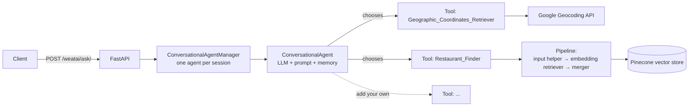

# Tastin Agent

**A conversational dining assistant built as a pluggable, tool-using AI agent.**

Ask Tastin things like *"Where can I get good ramen near Union Square?"* or *"Somewhere quiet for a date night around downtown Seattle?"* It works out what it needs to know, calls the right tools (geocoding, semantic restaurant search), and replies in a friendly way, with references to the businesses it used.

Restaurants are just the first domain. The agent loop, the tool interface and the API layer don't depend on food, so the same setup can power an assistant for hotels, events, real estate, or any field where answers come from your own data plus a few outside services.

---

## The idea

Most "chat with your data" apps follow one fixed path: take the question, fetch documents, generate an answer. That fails as soon as a question needs more than one step. *"Restaurants near the Space Needle"* can't be answered by searching for that phrase. You first have to turn the landmark into coordinates, then search near them.

Tastin treats this as a **reasoning problem, not a retrieval problem**:

1. **Think.** An LLM (GPT-4) reads the question and the conversation so far, and decides whether it can answer directly or needs more information.
2. **Act.** If it needs more, it picks a tool and writes the input for it, for example a location string for the geocoder or a JSON query with latitude and longitude for the restaurant finder.
3. **Observe.** The tool's result goes back to the agent as a trusted observation.
4. **Repeat or answer.** The agent chains as many tool calls as it needs, then writes a final answer plus a structured block listing which businesses it used.

```
User:    Any good dim sum near Pike Place Market?
Thought: I need the coordinates of Pike Place Market first.
Tool:    Geographic_Coordinates_Retriever
Input:   Pike Place Market, Seattle
Obs:     latitude:47.6097, longitude:-122.3422
Thought: Now search for dim sum around that location.
Tool:    Restaurant_Finder
Input:   {"Query": "dim sum", "Latitude": 47.6097, "Longitude": -122.3422}
Obs:     Business_id:abc123 Content: ...
Final Answer: Here are a few dim sum spots a short walk from the market ... 🥟
          {"references": {"business_id": ["abc123", ...]}, "show_references": true}
```

On top of that loop:

- **Memory per conversation.** Each `session_id` gets its own agent with summarised conversation memory, so follow-ups like *"what about something cheaper?"* just work.
- **Answers with references.** The agent returns the IDs of the businesses it used and decides whether the UI should show them, so a client can render cards, maps or links next to the text.
- **Replies in the user's language.** The agent answers in whatever language the user writes in.

---

## Built to be extended

Extensibility is the main design goal. Each part of the system is a replaceable block.



### Tools are pipelines

Every tool is a [Haystack](https://haystack.deepset.ai/) `Pipeline` wrapped in a `Tool` with a plain-language description. The agent reads those descriptions to decide when to use each tool. **No routing code is needed.** To add a skill:

1. Write a component (subclass `BaseComponent`, implement `run`).
2. Put it in a pipeline, chaining existing nodes if useful.
3. Register it as a `Tool` with a clear description of when to use it and what input it expects.
4. Add it to the agent's `tools=[...]` list.

```python
class OpeningHoursChecker(BaseComponent):
    outgoing_edges = 1

    def run(self, query: str, **kwargs):
        hours = lookup_hours(query)            # your API / DB call
        return {"hours_str": hours}, "output_1"

    def run_batch(self, *args, **kwargs):
        pass

pipeline = Pipeline()
pipeline.add_node(component=OpeningHoursChecker(), name="OpeningHours", inputs=["Query"])

opening_hours_tool = Tool(
    name="Opening_Hours_Checker",
    description="Useful when you need to know if a restaurant is open. Input is the business_id.",
    pipeline_or_node=pipeline,
    output_variable="hours_str",
)
```

Ideas that fit the same pattern: reservation availability, menu lookup, weather ("is it patio weather?"), travel time, user taste profiles, or reviews from a different source.

### Components can be reused

The `components/` folder holds small, single-purpose nodes you can reuse in any pipeline:

| Component | What it does |
|---|---|
| `GeographicCoordinatesRetriever` | Turns a free-text place name into latitude, longitude and a formatted address. |
| `EmbeddingRetrieverInputHelper` | Parses the agent's JSON tool input and builds a geographic bounding-box filter for vector search. It routes bad input back to the agent as a readable error so the agent can fix it and retry. |
| `DocumentMergerWithBusinessId` | Merges retrieved documents into one context block, tagging each with its `business_id` so the agent can cite it. |

### Every layer can be swapped

| Layer | Default | Swap for |
|---|---|---|
| LLM | OpenAI GPT-4 | Any model `PromptNode` supports |
| Embeddings | Cohere `embed-english-v2.0` | OpenAI, sentence-transformers, ... |
| Vector store | Pinecone | Any Haystack document store (Elasticsearch, Weaviate, FAISS, ...) |
| Memory | `ConversationSummaryMemory` | Window memory, a persistent store, ... |
| Persona and domain | "Tastin" dining prompt | Your own prompt: change the persona and rules, keep the agent loop |

Moving to a new domain mostly means indexing new documents, writing a new prompt and adding the tools that domain needs. The API, session handling and reference extraction stay the same.

---

## API

**`POST /weatai/ask/`**

Request:

```json
{
  "user_id": "u-123",
  "session_id": "s-456",
  "user_prompt": "Find me a cozy Italian place near Golden Gate Park"
}
```

Response:

```json
{
  "user_id": "u-123",
  "session_id": "s-456",
  "user_prompt": "Find me a cozy Italian place near Golden Gate Park",
  "agent_response_text": "Here are a few cozy Italian spots close to the park ...",
  "agent_references": {
    "references": { "business_id": ["id1", "id2"] },
    "show_references": true
  }
}
```

Reuse the same `session_id` to keep a conversation going.

---

## Getting started

Requires Python 3.10+.

```bash
pip install "farm-haystack[pinecone]" fastapi uvicorn requests
```

API keys are read from environment variables. Copy `.env.example` to `.env`, fill in your keys, and load them into your shell:

| Variable | Used for |
|---|---|
| `OPENAI_API_KEY` | The agent's LLM and conversation memory |
| `COHERE_API_KEY` | Query embeddings |
| `PINECONE_API_KEY` | The vector store |
| `GOOGLE_MAPS_API_KEY` | Geocoding place names |

```bash
cp .env.example .env    # then edit .env
set -a && source .env && set +a
uvicorn main:app --reload
```

The server stops at startup with a clear error if any key is missing. `.env` is git-ignored, so keys stay out of the repo.

You'll also need a Pinecone index of business documents with `business_id`, `latitude` and `longitude` in their metadata.

---

## Project layout

```
main.py                         FastAPI app and /ask endpoint
ConversationalAgentManager.py   Builds agents, tools and memory; one agent per session
components/                     Reusable Haystack nodes (geocoding, retrieval input, merging)
models/ApiModels.py             Request and response schemas
```
